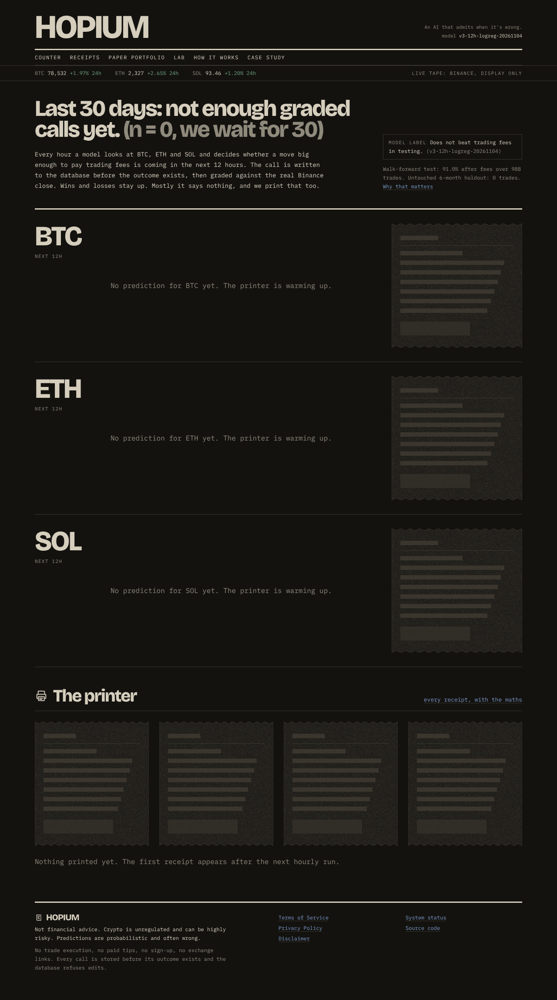
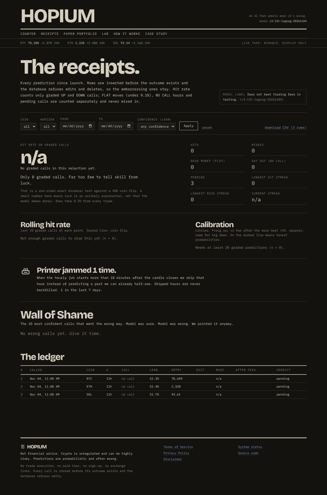
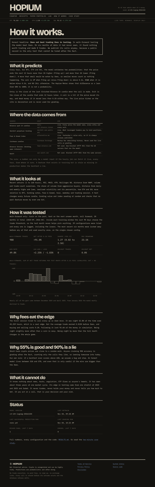
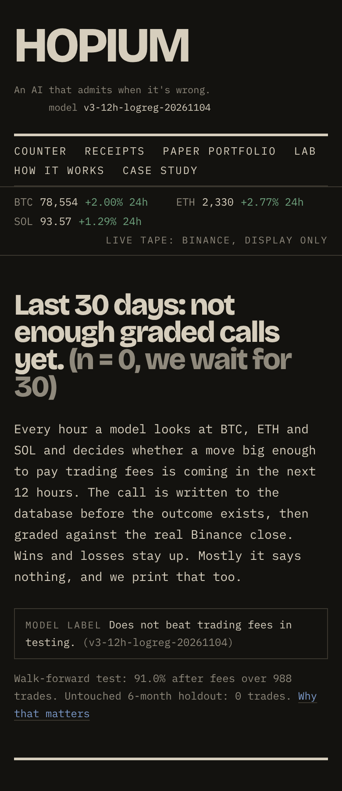

# HOPIUM

**An AI that admits when it's wrong.** Live: **https://hopium-phi.vercel.app**

A public crypto forecaster for BTC, ETH and SOL. Every hour a model decides whether a move big enough to pay trading
fees is coming in the next 12 hours. Each call is written to the database **before** the outcome exists, then graded
against the real Binance close. The database refuses edits and deletes, so the losers stay up. No trade execution, no
paid tips, no sign-up.

**Model label: Does not beat trading fees in testing.** Walk-forward: +91.0% after 0.2% fees over 988 trades
(Sharpe 1.27, 95% CI 0.02 to 2.50). Locked 6-month holdout: 0 trades, because the threshold chosen on the prior 90
days found nothing profitable. Full write-up: [`ml/RESULTS.md`](ml/RESULTS.md).



| Receipts | How it works | Phone |
|---|---|---|
|  |  |  |

## Architecture

```
 public data (reachable from US runners)       GitHub Actions                     Supabase Postgres                 Vercel (bom1)
 ┌──────────────────────────────┐  hourly   ┌─────────────────────────┐ service ┌─────────────────────────────┐ anon ┌──────────────────────┐
 │ Binance spot 1h candles      │ ───────▶  │ predict  (skip if late) │  key    │ predictions  (append-only)   │ read │ Next.js 14, read-only │
 │   data-api.binance.vision    │           │ grade    (1h closes)    │ ──────▶ │   insert <= 20 min of close  │ ───▶ │ receipts, stats, lab  │
 │ Deribit perpetual funding    │           │ candle cache, model row │         │   signal rule = CHECK        │      │ Wilson CI, binomial   │
 │ Fear & Greed (alternative.me)│           │ weekly retrain + gate   │         │   graded once, never edited  │      │ live tape: display    │
 └──────────────────────────────┘           │ ops output -> ml/ops/   │         │ run_log, model_runs, candles │      └──────────────────────┘
                                            └─────────────────────────┘         │ RLS: public SELECT only      │
                                                                                └─────────────────────────────┘
```

The same grading rule lives in three places and is tested to agree: `ml/hopium/grading.py` (training labels and the live
grader), the `outcome_matches_move` constraint in `supabase/schema.sql`, and `web/lib/grading.ts`.

## Repo

```
ml/          data, features, nested walk-forward research, live predict/grade      (DATA.md, EXPERIMENTS.md, RESULTS.md)
supabase/    schema.sql, migrations/, tests/ (31 schema-rule tests on PGlite)
.github/     hourly, retrain, keepalive, db-check, probe workflows
web/         Next.js site (TypeScript strict, Tailwind, Vitest)
docs/        screenshots
REVIEW.md    decision log, ban checklist, contrast results, Lighthouse scores
```

## Setup

**Database.** Create a Supabase project, then run `supabase/schema.sql` in the SQL editor (it includes every migration).

**GitHub Actions secrets** (Settings > Secrets and variables > Actions > Repository secrets):
`SUPABASE_URL` and `SUPABASE_SERVICE_ROLE_KEY`. The service-role key never leaves GitHub.

**Model (local).**

```bash
cd ml && pip install -r requirements.txt pytest
```

```bash
python -m pytest -q
```

```bash
python -m hopium.fetch && python -m hopium.deribit
```

```bash
python -m hopium.predict --dry-run
```

**Website (local).** Copy `web/.env.example` to `web/.env.local`, then:

```bash
cd web && npm install && npm run dev
```

Set `NEXT_PUBLIC_DATA_MODE=mock` to see labelled DEMO DATA without a database. Deploying: see [`VERCEL_SETUP.md`](VERCEL_SETUP.md).

**Checks.**

```bash
cd web && npm run lint && npm run typecheck && npm test && npm run build
```

```bash
cd supabase/tests && npm install && npm test
```

Not financial advice. Crypto is unregulated and can be highly risky. Predictions are probabilistic and often wrong.
